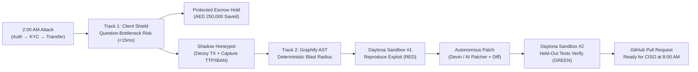

# 🛡️ Aegis 2AM — Autonomous Banking Immune System

> **The CIS Sprint x Devin (Dubai, Nov 21, 2026)**
> Built from scratch today to solve **both tracks simultaneously**: protecting **the little guy** (customer accounts & transactions) and **the big guy** (the bank's own infrastructure & code) at **2:00 AM in Dubai**.

---

## The Problem (2:00 AM in Dubai)

Everyone is asleep — customers and bank engineers alike. Attackers bypass 3 layers of defense (Session Auth → KYC Verification → Transfer Execution) and try to drain **AED 250,000** from a customer's account.

Existing solutions are split in half:
- Fraud platforms (BioCatch, Sardine, Kairos) score transactions *outside* the bank's codebase — they can block a transfer, but **cannot find or patch the code vulnerability** that let the attacker bypass KYC.
- Security coding agents (Aardvark, Patchlane) patch code — but **don't save the customer's money in real time** or trap the attacker during the live intrusion.

## Our Solution: Closed-Loop Autonomous Defense

**Aegis 2AM** closes the loop in seconds across **both tracks**:



---

## Sponsor Stack Integration

| Sponsor | Role in Aegis 2AM |
| :--- | :--- |
| **Cognition / Devin** | Autonomous remediation & PR engineering workflow |
| **Graphify** | Deterministic tree-sitter AST Knowledge Graph of the bank codebase (`EXTRACTED` call/import edges) for zero-hallucination blast-radius localization |
| **Daytona** | **Dual-Sandbox Verification**: Sandbox #1 reproduces the live exploit against unpatched bank code; clean Sandbox #2 verifies the patch against held-out regression tests the patcher never saw |
| **Collabute** | Voice-driven CISO / customer command interface (`POST /api/voice/command`) for morning incident triage & one-phrase actions |
| **Cap** | Demo recording & submission walkthrough |

---

## Quick Start

### Quick Start (Full Stack: Backend + War Room UI)
```bash
# 1. Backend
uv venv --python 3.11 .venv
uv pip install --python .venv/bin/python -e ".[dev,sponsors]"

# 2. Optional: connect live Daytona Cloud key from clipboard (stored securely in 1Password + .env)
./scripts/connect_daytona.sh

# 3. Frontend War Room UI
cd frontend && npm install && cd ..

# 4. Run Backend (:8000) + War Room UI (:3000) together
./scripts/start_dev.sh
```
Open War Room UI at **`http://localhost:3000`** and Swagger API docs at **`http://localhost:8000/docs`**.

### Run Tests
```bash
pytest -v
```

### API Docs & Teammate Contract
- Full REST + SSE specification: [`docs/API_CONTRACT.md`](docs/API_CONTRACT.md)
- Interactive Swagger UI: `http://localhost:8000/docs`
